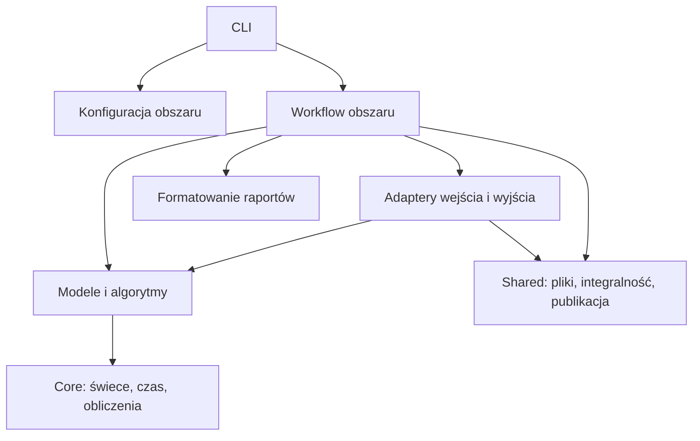

# Plan uporządkowania `src` bez zmiany zachowania

Data analizy: 2026-11-08. Status: plan wykonany na zlecenie autora.
Dokument zachowuje pierwotną analizę i kolejność prac; aktualny układ opisuje
[ARCHITECTURE.md](ARCHITECTURE.md), a wynik i zakres kontroli
[raport wykonania](refactoring/RAPORT_REFAKTORYZACJI_SRC.md).

## 1. Wniosek i zakres

Zachowujemy podział na obszary: przetwarzanie danych, wykresy, etykietowanie,
zbiory i ewaluację. Wprowadzamy wewnątrz nich powtarzalny podział według
odpowiedzialności: obliczenia i modele, koordynacja procesów, wejście/wyjście,
raportowanie oraz konfiguracja. Wspólne mechanizmy techniczne otrzymują własne
miejsce, a wspólna logika świec i czasu przestaje należeć do generatora syntetycznego.

To organizacja inspirowana podziałem domenowym, z prostymi funkcjami i istniejącymi
dataclass. Nie wymaga klas Service/Repository/Factory, kontenera zależności ani
nowego frameworka. Jest zgodna z zasadą prostoty z `.ai/RULES.md`.

Celami są łatwiejsze odnajdywanie kodu, czytelne zależności, rzeczywista
reużywalność i możliwość testowania obliczeń bez plików, HTTP i renderowania.
Liczba plików w katalogu jest sygnałem do przeglądu; nie stanowi samodzielnego
kryterium podziału. Nie dzielimy spójnej funkcji na mikropliki tylko dla limitu.

Pierwotne zlecenie obejmowało analizę i przygotowanie planu. Autor następnie
zlecił jego wykonanie; etapy poniżej są zapisem przyjętej procedury.

## 2. Stan ustalony z kodu

W `src/market_levels` jest 67 plików Python, w tym 13 `__init__.py`, łącznie
6689 linii fizycznych z komentarzami i pustymi liniami. W `tests` jest 29 plików
`test_*.py`. Są to pomiary dla stanu przed refaktoryzacją.

| Obszar | Obecna wielkość | Obserwacja |
| --- | ---: | --- |
| `data_processing/synthetic/` | 17 plików Python, 2124 linie | Konfiguracja, generatory, profile, estymacja, audyt i diagnostyka obok siebie. |
| `cli/` | 11 plików Python, 1003 linie | Większość poleceń ma 33–70 linii, ale runner eksperymentów ma 545. |
| `datasets/` | 7 plików Python, 926 linii | Planowanie, produkcja, diagnostyka, serializacja i kontrole integralności są częściowo wymieszane. |
| `charts/` | 4 pliki Python, 662 linie | Niewiele plików, lecz `diversity.py` ma 336 linii o kilku różnych odpowiedzialnościach. |
| `evaluation/` | 6 plików Python, 625 linii | Dobry początek podziału; kod techniczny jest pobierany z innych etapów aplikacji. |
| `labeling/` | 3 pliki Python, 385 linii | Spójny algorytm, ale `pilot.py` zawiera też wspólne funkcje plikowe i renderer nakładek. |
| `data_processing/windows/__init__.py` | 119 linii | W pliku inicjalizującym pakiet znajdują się model, selekcja i walidacja. |

### Najważniejsze problemy z odpowiedzialnościami

1. `charts/diversity.py` zawiera `SourceLedger`, hashowanie plików, czytanie
   treningowego CSV, budowanie okien, metryki, wyszukiwanie partii, walidację
   syntetyków i agregację wyników. Importują go m.in. planowanie zbioru,
   zatwierdzanie profili i ewaluacja, również wyłącznie dla `SourceLedger`.
2. `labeling/pilot.py` udostępnia `sha256`, `child`, `read_pilot` oraz
   `render_levels`. Korzystają z nich zbiory i ewaluacja. Operacje techniczne
   i odczyt pilotażu nie powinny wymagać zależności od procesu etykietowania.
3. `datasets/packaging.py` łączy instrukcję dla modelu, JSONL, statystyki,
   manifesty, publikację planu oraz tworzenie i odtwarzanie próby. Ewaluator
   importuje z niego nawet samo `seal` i `verify_files`.
4. `datasets/production.py` zawiera budowę i pełną weryfikację zbioru oraz
   pomocniczą serializację i kontrolę ścieżek. `build_dataset` ma 91 linii,
   a `verify_dataset` 129. Te dwa procesy warto rozdzielić.
5. `cli/refinement_comparison.py` ma 545 linii. `preflight` ma 117 linii,
   a `execute` 138. Ten moduł oprócz argumentów CLI realizuje kontrolę
   instalacji, planowanie etapów, subprocess, blokadę, checkpointy, wznowienie,
   kontrolę MAX_PATH i raportowanie.
6. `synthetic/calibration.py` odpowiada jednocześnie za estymację, schemat v1,
   zatwierdzanie, hashowanie, walidację okresu, zapis i wybór walidatora v1/v2.
   Generatory muszą przez to importować moduł estymacji dla samej walidacji profilu.
7. `synthetic/quality.py` zawiera wspólne `validate_values`, `canonical_hash`
   i `distribution`. Używają ich również rzeczywiste okna, renderer,
   etykietowanie i ewaluacja. Ich lokalizacja sugeruje błędnie, że dotyczą
   wyłącznie danych syntetycznych.

### Zależności cykliczne

Analiza AST wszystkich importów, także wewnątrz funkcji, wskazuje dwie grupy
modułów wzajemnie osiągalnych:

- `synthetic/settings.py` i `synthetic/v2_parameters.py`;
- `calibration`, `calibration_v2`, `comparison`, `generator`, `generator_v2`,
  `profile_v2`, `refinement`, `selection`, `training_period` w `synthetic`.

Nie stwierdzono cykli w grafie samych importów na poziomie modułu. Część
zależności odroczono do wnętrza funkcji, więc działające importowanie aplikacji
nie przeczy temu wynikowi. To problem organizacji zależności, nie stwierdzenie,
że obecny program nie działa.

Przykłady: ustawienia importują parametry v2 podczas walidacji, a parametry
importują walidator liczb z ustawień. Walidacja profilu v2 importuje ustawienia
kalibracji i audyt refinement z modułów, które uruchamiają generator.

### Co już jest dobrze zorganizowane

- `src-layout`, pakiet `market_levels`, względne importy i entry pointy;
- oddzielenie HTTP, archiwów i parsera w `real/binance_vision/`;
- niezależne CLI oraz istniejące mechanizmy atomowej publikacji i retry Windows;
- testy kontraktów, wzorce regresyjne, odtwarzanie OHLC, etykiet i PNG;
- sam algorytm etykietowania: 159 linii tworzy spójną, czytelną całość;
- małe `configuration.py`, `core/candles.py` i `core/periods.py` nie wymagają
  rozbudowanych abstrakcji.

Przestrzenie `modeling/`, `training/` i `inference/` pozostają planowane.
`experiments/` otrzyma wyłącznie istniejącą koordynację refinement przeniesioną
z CLI; nie oznacza implementacji nowych eksperymentów.

## 3. Powtarzalny układ i reguły zależności

| Nazwa | Zawartość | Dopuszczalne zależności |
| --- | --- | --- |
| `domain/` | Modele, algorytmy, deterministyczne transformacje i reguły walidacji. | Biblioteka standardowa, `core`, własne proste ustawienia, jawne API obliczeniowe innych obszarów. |
| `workflows/` | Przypadki użycia: planowanie, generowanie, budowa, weryfikacja, porównanie. | `domain`, `config`, `io`, `reporting`, `shared`, jawne API innych obszarów. |
| `io/` | Czytanie i zapis formatów właściwych obszarowi, zewnętrzne adaptery. | Własne modele i walidatory, `core`, `shared`; bez importowania workflow. |
| `reporting/` | Składanie Markdown i innych prezentacji gotowych wyników. | Gotowe struktury wyników i lekkie kontrakty; bez uruchamiania obliczeń lub zapisu. |
| `config/` lub `config.py` | Rzeczywiście używane ustawienia i ich walidacja. | Lekkie modele parametrów i walidatory; bez generatorów, workflow i raportów. |
| `cli/` | Parsowanie argumentów, wywołanie przypadku użycia, komunikaty i kody zakończenia. | Konfiguracja i publiczne funkcje workflow. |

Nie tworzymy wszystkich pięciu katalogów w każdym obszarze. Pojedyncza
odpowiedzialność może zostać w jednym pliku, np. `evaluation/protocol.py`
albo `datasets/config.py`. Katalog pojawia się, kiedy grupuje kilka istniejących
odpowiedzialności. Krótkie pakiety techniczne `core`, `shared` i adapter Binance
mają układ odpowiadający ich roli bibliotecznej.

Wewnątrz większego `domain` dopuszczamy podział według zadania, np.
`generation/`, `profiles/`, `calibration/`. Ustawienia i stałe mają właściciela:
parametry generatora są przy generatorze, protokół ewaluacji przy ewaluacji.
Nie powstaje globalny katalog „zmienne” ani ogólny `utils.py`.

Przepływ zależności ma wyglądać tak:



`core` nie importuje obszarów aplikacji ani wykonawczego I/O. `shared` korzysta
wyłącznie z biblioteki standardowej i własnych modułów. Żaden obszar nie importuje
`cli`. Obszary nie importują nawzajem prywatnych funkcji pilotażu dla obsługi plików.
Zależności rzeczywiście potrzebne, np. datasets → labeling i evaluation → ATR,
pozostają jawne. Nie zastępujemy ich systemem zdarzeń ani interfejsów.

## 4. Proponowana struktura

Poniższe ścieżki są docelowe; szczegółowa mapa przenosin jest w następnej sekcji.
Pominięto `__init__.py` oraz README. Nie jest to polecenie tworzenia pustych plików.

```text
src/market_levels/
    configuration.py                 # dotychczasowa konfiguracja pobierania
    cli/                             # te same ścieżki modułów i polecenia
    core/
        ohlc/
            model.py
            validation.py
            identity.py
        time/
            calendar.py
            periods.py
        numeric/
            validation.py
            statistics.py
            atr.py
    shared/
        integrity.py
        paths.py
        publication.py
        manifests.py
        json_io.py
    data_processing/
        io/
            candles.py
            chronology.py
        real/
            binance_vision/           # zachowany dobry podział adaptera
                client.py
                archives.py
                parsing.py
            workflows/download.py    # ten sam mały koordynator pobierania
        windows/
            domain/
                models.py
                candidates.py
                selection.py
            io/training_csv.py
        synthetic/
            config/
                regimes.py
                generation.py
                calibration.py
                refinement.py
            domain/
                parameters.py
                quality.py
                generation/
                    models.py
                    seeds.py
                    v1.py
                    v2.py
                    regimes.py
                    processes.py
                    dispatch.py
                profiles/
                    v1.py
                    v2.py
                    validation.py
                calibration/
                    features.py
                    objectives.py
                    candidates.py
                diagnostics.py
            io/
                profiles.py
                batches.py
            workflows/
                generation.py
                calibration.py
                refinement.py
                comparison.py
                summary.py
            reporting/
                comparison.py
                variants.py
    charts/
        config.py
        domain/
            metrics.py
            selection.py
            diversity.py
            validation.py
        io/
            rendering.py
            audit_sources.py
            pilot.py
        workflows/audit.py
        reporting/audit.py
    labeling/
        domain/
            models.py
            algorithm.py
        io/overlays.py
        workflows/
            pilot.py
            verification.py
        reporting/pilot.py
    datasets/
        config.py
        domain/
            examples.py
            audit.py
        io/outputs.py
        workflows/
            planning.py
            approval.py
            smoke.py
            production.py
            verification.py
            review.py
    evaluation/
        protocol.py
        domain/
            models.py
            responses.py
            matching.py
            scoring.py
            metrics.py
            comparison.py
        io/
            inputs.py
            reports.py
        workflows/
            evaluate.py
            compare.py
            verification.py
        reporting/markdown.py
    experiments/
        refinement/
            config.py
            paths.py
            io.py
            domain/plan.py
            workflows/
                preflight.py
                runner.py
            reporting.py
    modeling/                        # nadal tylko istniejące README
    training/
    inference/
```

`generation/` ma więcej plików, ale wszystkie realizują jedno konkretne zadanie.
Dodatkowe rozbijanie go na podkatalogi dla pojedynczych funkcji nie poprawiłoby
nawigacji. Analogicznie pozostawiamy płaskie `cli/`: nazwy poleceń są stabilnymi,
łatwymi do wyszukania wejściami do aplikacji; duża implementacja runnera stamtąd znika.

## 5. Mapa przenosin i podziału kodu

Ścieżki źródłowe poniżej są względne do `src/market_levels/`.

### 5.1. Wspólna logika i obsługa artefaktów

| Obecnie | Docelowo i zakres |
| --- | --- |
| `core/candles.py` | `core/ohlc/model.py`: ten sam `Candle`, wyjątek, UTC i odstęp. |
| `core/periods.py` | `core/time/calendar.py`: obecne operacje na miesiącach i dniach. |
| `data_processing/validation.py` + `synthetic/quality.validate_values` | `core/ohlc/validation.py`: walidacja OHLC i szeregu; zachowanie kolejności kontroli i wyjątków. |
| `synthetic/quality.canonical_hash` | `core/ohlc/identity.py`: ten sam hash cen, bez dat i pochodzenia. |
| `synthetic/settings.positive_int`, `finite_number` | `core/numeric/validation.py`: istniejące reguły typów, w tym odrzucanie bool. |
| `synthetic/quality.distribution` | `core/numeric/statistics.py`: dotychczasowe statystyki; wspólny kwantyl dopiero po osobnym dowodzie zgodności. |
| `synthetic/calibration.validate_period` + model i walidacja z `training_period.py` | `core/time/periods.py`: jawne okresy i `ChronologicalSplit`; odczyt pliku osobno. |
| `training_period.load_chronological_split` | `data_processing/io/chronology.py`: odczyt tej samej sekcji JSON i ta sama obsługa błędów. |
| `labeling/algorithm`: `DECIMAL_CONTEXT`, `true_ranges`, `wilder_atr` | `core/numeric/atr.py`: wspólne obliczenia dla etykietowania i ewaluacji. Kontekst pozostaje ustawiany w dotychczasowych miejscach wywołania. |
| `charts/diversity.SourceLedger` i implementacje SHA plików | `shared/integrity.py`: rejestr źródeł i hashowanie bajtów; konsolidacja po kontroli kontraktów błędów. |
| `labeling/pilot.child`, `charts/diversity._child`, `synthetic/comparison._batch_path` | `shared/paths.py`: wspólny mechanizm ograniczenia ścieżki; lokalne komunikaty i dodatkowe warunki pozostają zachowane. |
| `charts/renderer.require_short_path` | `shared/paths.py`: dotychczasowa kontrola długości UTF-16; przewidywanie drzewa runnera nadal należy do eksperymentu. |
| `data_processing/staging.py` | `shared/publication.py`: przeniesienie istniejącej implementacji retry, publikacji i sprzątania. |
| `datasets/packaging.seal`, `verify_files` | `shared/manifests.py`: dokładnie obecny format zapieczętowanych katalogów. Nie migrujemy do niego innych formatów manifestów. |
| `data_processing/storage.py` | CSV → `data_processing/io/candles.py`; obecne `write_json` → `shared/json_io.py`. |
| `data_processing/pipelines/download.py` | `data_processing/real/workflows/download.py`: ta sama funkcja `run`, bliżej obszaru pozyskiwania danych; adapter Binance zachowuje wewnętrzny podział. |

### 5.2. Okna i dane syntetyczne

| Obecnie | Docelowo i zakres |
| --- | --- |
| `windows/__init__.py` | `domain/models.py`: `Window`; `domain/candidates.py`: kandydaci, walidacja i coverage; `domain/selection.py`: wybór train. Inicjalizator tylko eksportuje świadomie wybrane API. |
| `synthetic/selection.py` | `windows/domain/selection.py`: osobna funkcja diagnostyczna `select_real_windows`, obok, ale bez połączenia z selekcją produkcyjną. |
| `charts/diversity.training_windows`, `read_training_csv` | Odpowiednio `windows/domain/candidates.py` i `windows/io/training_csv.py`. Zachowanie osobnej siatki oraz zatrzymania odczytu po treningu. |
| `synthetic/settings.py` | `synthetic/config/regimes.py`: ustawienia faz; `config/generation.py`: ustawienia generatora i loader. Wspólne walidatory liczb są już w core. |
| `synthetic/v2_parameters.py` | `synthetic/domain/parameters.py`: parametry, warianty i przełączniki; brak importu ustawień generatora. |
| `synthetic/generator.py` | Model wyniku → `domain/generation/models.py`; seedy → `seeds.py`; generator v1 → `v1.py`. Stałe wersji i indeksu symulacji pozostają przy generowaniu, z jawnym właścicielem. |
| `generator_v2.py`, `regimes.py`, `stochastic_processes.py`, `dispatch.py` | `domain/generation/v2.py`, `regimes.py`, `processes.py`, `dispatch.py`; przeniesienie ciał funkcji bez zmiany wzorów i kolejności RNG. Wspólne nazwy strumieni nie wymagają importowania generatora. |
| `synthetic/quality.py` | Walidacja syntetyczna i statystyki szeregu → `domain/quality.py`; funkcje ogólne wcześniej wyodrębnione do core. |
| `synthetic/calibration.py` | Profil diagnostyczny v1, hash, zatwierdzanie i walidator v1 → `domain/profiles/v1.py`; estymacja i odczyt CSV → `workflows/calibration.py`; zapis/odczyt profili → `io/profiles.py`. |
| `synthetic/profile_v2.py` | Budowa profilu i konfiguracja reżimów → `domain/profiles/v2.py`; pełna walidacja v2 i wybór schematu → `domain/profiles/validation.py`. |
| `synthetic/calibration_v2.py` | Ustawienia/loader → `config/calibration.py`; cechy i diagnostyka zmienności → `domain/calibration/features.py`; cel → `objectives.py`; wyszukiwanie → `workflows/calibration.py`. |
| `synthetic/refinement.py` | Ustawienia i definicja protokołu → `config/refinement.py`; cele → `domain/calibration/objectives.py`; kandydaci → `candidates.py`; pełna walidacja audytu → `domain/profiles/validation.py`; wykonanie → `workflows/refinement.py`. |
| `synthetic/comparison.py` | Metryki, agregacja, różnice → `domain/diagnostics.py`; odczyt i kontrola partii → `io/batches.py`. |
| `synthetic/experiments.py` | Odczyt i zestawianie raportów → `workflows/summary.py`; czyste pomocnicze obliczenia → `domain/diagnostics.py`; Markdown → `reporting/variants.py`. |
| `pipelines/synthetic.py` | Koordynacja generacji → `synthetic/workflows/generation.py`; wczytanie i bramka profili → `synthetic/io/profiles.py`. |
| `pipelines/compare_synthetic.py` | Budowa i zapis porównania → `synthetic/workflows/comparison.py`; tekst podsumowania → `reporting/comparison.py`. |

Usunięcie cykli wymaga rozdzielenia obliczeń celu i walidacji od uruchamiania
symulacji. `profiles/validation.py` może korzystać z ustawień wyszukiwania,
funkcji celu i listy kandydatów, ale nie importuje workflow kalibracji,
refinement ani generatora.

Pełna walidacja v2 i walidacja jego audytu są celowo w tym samym module:
obecny audyt waliduje też profil źródłowy. Dzięki temu zachowujemy kolejność
kontroli i wzajemne wywołania funkcji bez cyklu między modułami. Nie rozwiązujemy
problemu przez wyłączenie walidacji, rozszerzenie tolerancji ani framework callbacków.

### 5.3. Wykresy, etykiety, zbiory i ewaluacja

| Obecnie | Docelowo i zakres |
| --- | --- |
| `charts/diversity.py` | Metryki → `charts/domain/metrics.py`; statystyki faz → `domain/diversity.py`; wyszukiwanie i odczyt istniejących partii → `io/audit_sources.py`. Ledger, CSV i okna przeniesione wcześniej. |
| `charts/renderer.py` | Reguły wyglądu → `charts/config.py`; kontrola renderowalnego okna → `domain/validation.py`; budowa figury i zapis PNG → `io/rendering.py`. Import Matplotlib nadal opóźniony. |
| `charts/pilot.py` | `tags`, `select_pilot` → `domain/selection.py`; `_audit_markdown` → `reporting/audit.py`; `run_audit` → `workflows/audit.py`. |
| `labeling/pilot.read_pilot` | `charts/io/pilot.py`: adapter istniejącego formatu pilotażu, wraz z obecnym wymaganiem 32 przykładów. |
| `labeling/algorithm.py` | Dataclass i serializacja wyniku → `labeling/domain/models.py`; algorytm → `domain/algorithm.py`; ATR wcześniej w core. Nie rozbijamy każdego kroku na osobny plik. |
| `labeling/pilot.py` | `render_levels` → `io/overlays.py`; run → `workflows/pilot.py`; verify → `workflows/verification.py`; summary/Markdown → `reporting/pilot.py`. |
| `datasets/planning.py` | Loader konfiguracji i składanie ustawień → `datasets/config.py`; planowanie i kontrola historii seedów → `workflows/planning.py`. |
| `datasets/packaging.py` | Instrukcja, JSONL i metadane → `domain/examples.py`; `summarize` → `domain/audit.py`; reguły output → `io/outputs.py`; próba → `workflows/smoke.py`; verify → `workflows/verification.py`; publikacja planu → `workflows/planning.py`. Manifesty wcześniej w shared. |
| `datasets/production.py` | Budowa → `workflows/production.py`; pełne odtworzenie → `workflows/verification.py`; nazwy plików, ID, JSONL i metadane → `domain/examples.py`; output → `io/outputs.py`. |
| `datasets/approval.py`, `audit.py`, `review.py` | Odpowiednio `workflows/approval.py`, `domain/audit.py`, `workflows/review.py`; funkcja zatwierdzania profilu może pozostać przy workflow, bez nowej hierarchii klas. |
| `evaluation/scoring.py` | Dataclass → `domain/models.py`; parser → `domain/responses.py`; matching → `domain/matching.py`; `score_example` i kontekst użycia ATR → `domain/scoring.py`. |
| `evaluation/metrics.py`, `inputs.py` | Odpowiednio `domain/metrics.py` i `io/inputs.py`; algorytmy i reguły kompletności pozostają te same. |
| `evaluation/pipeline.py` | evaluate/compare/readback → osobne `workflows/evaluate.py`, `compare.py`, `verification.py`; `_delta` i treść porównania → `domain/comparison.py`; `_markdown` → `reporting/markdown.py`; zapis → `io/reports.py`. |
| `evaluation/protocol.py` | Pozostaje spójnym modułem protokołu, z własnym ścisłym JSON i niezmienionym hashem reguł. |

Weryfikatory i twórcy artefaktów zachowują niezależne kontrole kompletności,
hashy, schematu, PNG i liczebności. Nie redukujemy weryfikacji do ponownego
wywołania tej samej funkcji zapisującej. Dzielimy duże pętle na pomocnicze kroki
dopiero po bezpiecznym przeniesieniu i porównaniu ich wyników.

### 5.4. Koordynator eksperymentów i interfejsy

Z `cli/refinement_comparison.py` do `experiments/refinement/` przechodzą:

- stałe istniejących doświadczeń → `config.py`;
- `longest_output_path`, `validate_output_paths` → `paths.py`;
- `read_json`, `sha`, `cli`, `exclusive_json`, `unique_file`, `run_lock`
  i kontrole checkpointów → `io.py`, z użyciem shared tam, gdzie kontrakt jest wspólny;
- `experiment_tasks` → `domain/plan.py`;
- `check_environment`, `preflight` → `workflows/preflight.py`;
- `execute`, obsługa rozpoczęcia/wznowienia i zapisu błędu → `workflows/runner.py`;
- `fresh_summary_markdown` → `reporting.py`.

Dotychczasowy moduł CLI zachowuje parser, `main` i te same argumenty. Pozostałe
CLI otrzymują tylko aktualizację importów do workflow. Zachowujemy wszystkie
polecenia z `pyproject.toml`, ścieżki `python -m market_levels.cli.*`, argumenty,
wartości domyślne, pierwszeństwo CLI nad JSON, stdout/stderr i kody zakończenia.

Wewnętrzne ścieżki importów mogą się zmienić; wszystkie znane użycia w kodzie,
testach i skryptach aktualizujemy w tym samym etapie. Eksporty `__init__.py`
służą małemu, świadomie określonemu API pakietu. Nie zostawiamy masowo pustych
modułów pod starymi ścieżkami i nie przywracamy usuniętego `src.download_data`.

## 6. Co współdzielić, a co zachować osobno

### Współdzielenie z konkretnym uzasadnieniem

- **Integralność plików:** obecnie SHA pliku jest liczone m.in. w adapterze
  archiwów, audycie wykresów, pilotażu etykietowania i runnerze. Wspólny wynik
  to hash tych samych bajtów; przenosimy implementacje i sprawdzamy przypadki
  błędów przed zastąpieniem ich jedną funkcją. `SourceLedger` otrzymuje jednego
  właściciela poza wykresami.
- **Kontrola ścieżek:** wspólny mechanizm `resolve` i sprawdzenia potomka,
  przy zachowaniu różnych dozwolonych katalogów, tekstów błędów i kontroli
  symlinków. Nie ujednolicamy automatycznie całych polityk output.
- **Manifesty katalogowe:** istniejące `seal` i `verify_files` trafiają do
  shared. Format manifestu pobierania, partii syntetycznej i pilotażu pozostaje
  odrębny; współdzielone są tylko zgodne operacje techniczne.
- **JSONL przykładów:** `_example_line` i `json_line` różnią się głównie
  wartością split. Docelowo jedna funkcja przyjmie `str | None`, zachowując
  kolejność pól, białe znaki, końcowy newline i wstawianie liczbowego JSON etykiety.
- **Obliczenia i walidacja:** wspólne OHLC, okresy, hash cen, proste statystyki,
  walidacja liczb i ATR mają jedno źródło; specyficzne kontrole pozostają przy etapach.
- **Testowe dane pomocnicze:** fixture używane przez różne testy przechodzą do
  `tests/support/`. Obecnie np. test runnera importuje `small_search` z innego
  testu integracyjnego oraz `real_fixture` z testu jednostkowego.

### Podobieństwa, które nie uzasadniają połączenia algorytmów

| Przypadek | Różnica, którą zachowujemy |
| --- | --- |
| Selekcja okien | Diagnostyka losuje przydział pojemności i położenia rozłącznych okien; produkcja wybiera train z warstw chronologicznych; pilot pokrywa kategorie. To trzy różne reguły. |
| Siatka okien | `training_windows` ma stałe pozycje w ciągłych fragmentach; kandydaci zbioru dodatkowo respektują split, stride i raportowanie końcówek. Wspólne mogą być dopiero zgodne prymitywy fragmentacji. |
| Statystyki świec | `quality._series_observations` liczy proporcje po konwersji cen do float i przypisuje 0 świecy o zerowym zakresie; `charts.window_metrics` używa również ilorazów Decimal i pomija takie świece w średnich proporcji. Nie zastępujemy jednego drugim. |
| JSON | Zapis raportów, kanoniczny hash profilu, etykiety z dwoma miejscami i JSON ewaluacji z Decimal mają różne kontrakty. Nie powstaje jeden domyślny serializer dla wszystkiego. |
| Hashe | Hash pliku, hash cen, hash profilu, fingerprint ewaluacji i skrócone ID mają różne wejścia i kodowania. Nie zmieniamy kanonizacji ani długości ID. |
| CSV | Parser treningowy kończy przed analizą OHLC po treningu; ogólny czytnik CSV przetwarza cały plik i ma inne kontrole. Nie zastępujemy go filtrowaniem pełnego odczytu. |
| Profile i cele | Wersje v1/v2, cel kalibracji i cel refinement mają różne reguły. Współdzielimy rzeczywiście wspólne części, zachowując schematy i osobne cele. |
| Weryfikacja | Powtórne kontrole twórcy i weryfikatora są częścią zabezpieczenia przed uszkodzeniem danych. Ich podobieństwo nie jest automatycznie zbędną duplikacją. |

Kwantyl liniowy jest kandydatem do współdzielenia dopiero po sprawdzeniu tych
samych wyników i walidacji dla różnych długości, singletonu, danych pustych
i niefinitywnych. Pierwszy etap przenosi istniejące funkcje bez wymuszonej konsolidacji.

## 7. Kontrakt zachowania

Refaktoryzacja może zmienić lokalizację definicji i wewnętrzne importy.
Nie może zmienić:

1. Wzorów, kolejności operacji numerycznych, konwersji Decimal/float,
   kontekstów Decimal, zaokrągleń i obowiązujących tolerancji.
2. Źródeł RNG, nazw strumieni, sposobu wyprowadzania seedów, liczby i kolejności
   losowań, kolejności kandydatów oraz reguł remisów. Bez równoległej generacji.
3. Zachowania walidacji: odrzucanych wejść, typów i komunikatów wyjątków,
   kolejności kontroli i momentu powstania efektów ubocznych.
4. Formatów i bajtów deterministycznych wyników: CSV, JSON/JSONL etykiet,
   metadanych, raportów, ID i hashy; także kolejności pól, wpisów i nowych linii.
5. Wyglądu PNG, metadanych obrazu, wersji algorytmów/renderera/protokołu
   i rozdziału nakładek diagnostycznych od wejścia VLM.
6. Konfiguracji badawczej, reguł train/validation/test, granic UTC, stride,
   liczebności, statusów profili, wymogu approved i kontroli kolizji seedów.
7. Reguł pobierania, CHECKSUM, retry HTTP, dziennego fallbacku, `strict_gaps`
   i kolejności zapisu CSV/raportu/manifestu, również istniejących ograniczeń.
8. Odmowy nadpisania, atomowości, retry Windows, obsługi pozostałości stagingu,
   blokad, checkpointów i zachowania pierwotnego wyjątku.

Ścieżki w tracebackach i `__module__` przeniesionych definicji naturalnie się
zmienią; nie są utożsamiane z niezmiennością wyników algorytmów. Przed usunięciem
starej ścieżki należy jeszcze sprawdzić użycia `pickle` i importów dynamicznych,
jeżeli takie pojawią się w dalszej analizie wykonawczej.

**Ważny kontrakt runnera:** `preflight` przypina SHA wszystkich plików Python
w `src/market_levels`. Po refaktoryzacji dawny `run.json` nadal powinien odrzucać
wznowienie zmienionym kodem. Nie przepisujemy historycznych hashy ani checkpointów.
Wznawianie w obrębie nowej, niezmienionej wersji ma działać jak wcześniej.
Jest to zachowanie istniejącej ochrony, a nie powód do wyłączenia kontroli kodu.

## 8. Zabezpieczenie przed regresją

### 8.1. Punkt odniesienia

Przed pierwszym przeniesieniem kodu:

1. Ponownie sprawdzić stan repozytorium i środowiska. Zachować wskazanie
   wyjściowej rewizji, wersje Python, Matplotlib i fontów oraz wynik testów.
2. Zapisać poza chronionymi danymi inwentarz ścieżek i SHA-256 istniejących
   plików w `data/` i historycznych wynikach `results/`, bez katalogów prób
   tworzonych przez testy. Hash porównywać razem z listą plików, aby wykryć
   również usunięcia i dopisania. Zachować osobno kopię stanu źródeł potrzebną
   do porównania starej i nowej implementacji.
3. Zachować istniejące `pipeline_baseline.json`, `synthetic_v1_regression.json`,
   `synthetic_v2_regression.json` i fixture ewaluacji bez aktualizacji oczekiwań.
   Wzorce generatorów wiążą się z CPython 3.13.15; pominięty test wzorca na
   innym środowisku nie potwierdza zgodności.
4. Przed zmienianymi ścieżkami dopisać brakujące testy charakteryzujące obecne
   zachowanie. Wzorce powstają ze starego kodu, a nie z wyniku po refaktoryzacji.

### 8.2. Zakres porównań

| Obszar | Kontrola równoważności |
| --- | --- |
| Pobieranie | Istniejący ZIP testowy, pełny CSV, raport, manifest i stdout; przypadki offline/fallback/strict-gaps. Sieć wyłącznie mockowana. |
| Generatory | Oba symbole, v1 i wszystkie sześć obecnych wariantów v2, stałe seedy; dokładne OHLC, metadane, profile, identyfikatory i round-trip CSV. |
| Kalibracja/refinement | Małe sztuczne referencje i siatki; identyczne listy prób, loss, kolejność i wybrany kandydat, także remisy i walidacja audytu. Bez ponawiania kalibracji rynku. |
| Okna | Te same indeksy źródłowe, fragmenty przy lukach, granice splitów, raporty, kolejność i reguły selekcji, w tym count=0 tam, gdzie jest dozwolone. |
| Etykietowanie | Dokładne `target_json`, pełna diagnostyka, ATR, kolizje, remisy, brak poziomów, płaskie świece i niezależność od metadanych generatora. |
| Wykresy | SHA PNG i nakładek w tym samym środowisku; brak zmiany parametrów, kolejności rysowania i importowania Matplotlib przy samych obliczeniach. |
| Zbiory | Nowa mała produkcja w izolacji, pełna lista plików, JSONL, metadane i odtworzenie; próby uszkodzenia, nadmiarowego pliku, duplikatu i niekompletnego planu. |
| Ewaluacja | Fixture A/B, identyczne wyniki jednostkowe, micro-F1/MAE, matching, Decimal JSON, hash protokołu, raport i sparowane delty; brakujące/błędne ID nadal blokują raport. |
| Publikacja/runner | Retry i sprzątanie na Windows, awarie przed i po publikacji, MAX_PATH, blokada, wznowienie i odrzucenie zmiany kodu/wejść; małe fixture zamiast historycznych eksperymentów. |

Do porównań deterministycznych zamrażamy lub normalizujemy wyłącznie faktycznie
zmienne pola: UUID przebiegu, czas utworzenia, ścieżkę katalogu tymczasowego
i wskazanie runtime, gdy wymaga tego konkretny test. Każde takie pole jest jawnie
wymienione w teście. Nie usuwamy całych sekcji metadanych ani nie dodajemy
ogólnej tolerancji float dla wygodnego przejścia porównania.

Tworzenie wyniku dwa razy przez tę samą nową implementację sprawdza
deterministyczność, ale nie dowodzi zgodności ze starą. Potrzebne są niezmienne
wzorce lub porównanie starego i nowego kodu na tych samych wejściach.

### 8.3. Istniejące lokalne artefakty

Po zmianach obszaru renderowania, etykietowania i zbiorów przeprowadzić także
odczyt istniejących lokalnych artefaktów i odtworzenie do katalogów tymczasowych:
pilotażu 32 obrazów, wyników etykietowania oraz zbioru 800 przykładów, jeżeli
nadal są dostępne. Weryfikacja istniejącego zbioru nie jest jego ponowną budową.
Nie uruchamiać `build` z historycznym seedem, aprobowania profili ani RunFull.

Przykładowe końcowe polecenie zachowuje obecny interfejs:

```powershell
.\.venv\Scripts\python.exe -m market_levels.cli.build_dataset verify --output data/datasets/ds35-800-20261107-a
```

Przed wykonaniem sprawdzić rzeczywiste ścieżki i wersje środowiska. Niedostępny
artefakt oznacza niewykonany zakres kontroli, który trzeba podać w raporcie.
Różnicy PNG nie akceptujemy przez domyślne włączenie `allow_renderer_difference`.

## 9. Kolejność wykonania i bramki zakończenia

Każdy etap obejmuje aktualizację wszystkich jego użytkowników w `src`, testach
i aktywnych skryptach. Kończy się działającym stanem; kolejne przenosiny nie
mogą być sposobem na odłożenie nierozwiązanego błędu importu.

| Etap | Konkretna praca | Warunek przejścia dalej |
| --- | --- | --- |
| 0. Zamrożenie zachowania | Inwentarz danych i kodu, wynik środowiska, testy, wzorce brakujących kontraktów, mapa eksportów. | Znany wynik bazowy i dostępne porównanie starej/nowej wersji; istniejące błędy oddzielone od zadania. |
| 1. Wspólne operacje plikowe | Wydzielenie `shared`: ledger, hashe, ścieżki, publikacja, manifesty, zapis JSON. Najpierw ruch definicji; dopiero osobno konsolidacja zgodnych duplikatów. | Testy integralności, stagingu, retry, manifestów, CLI i cały dotychczasowy zestaw przechodzą; te same bajty i błędy. |
| 2. Core i okna | Model, walidacja, czas, liczby, ATR; I/O CSV; podział `windows/__init__.py`; przeniesienie trzech odrębnych mechanizmów okien. | Identyczne ceny, hashe, ATR, indeksy i dobór okien; core nie importuje obszarów aplikacji. |
| 3. Synthetic | Podział konfiguracji, profili, generacji, celów, diagnostyki, I/O i workflow; usunięcie dwóch grup cykli. Najpierw bez zmian ciał algorytmów. | Niepominięte wzorce v1/v2, małe kalibracje/refinement, testy partii i porównań; graf importów, także lokalnych, bez tych cykli. |
| 4. Runner refinement | Wydzielenie istniejącego kodu do `experiments/refinement`, pozostawienie adaptera CLI. | CheckOnly, mały smoke/wznowienie na fixture, MAX_PATH i blokady; stare checkpointy nie są przepisywane. |
| 5. Charts i labeling | Rozdział metryk, odczytu pilotażu, renderera, nakładek, raportów i workflow; rozdzielenie modeli od etykietowania. | Te same etykiety/diagnostyka i SHA obrazów; przeniesione API pilotażu nie wymaga workflow etykietowania. |
| 6. Datasets | Konfiguracja, format przykładu, audyt, osobne planowanie/budowa/próba/weryfikacja/review; jedna serializacja JSONL ze świadomym split. | Istniejące testy i porównanie artefaktów; weryfikacja lokalnego zbioru 800, jeśli dostępny; brak zmian historycznych danych i profili. |
| 7. Evaluation | Modele, parser, matching, scoring, wejścia, zapis, raporty i workflow; usunięcie zależności od packaging/pilot/diversity dla funkcji technicznych. | Fixture A/B i komplet wyników/raportów identyczne; protokół i jego SHA bez zmian; brak inferencji. |
| 8. Testy, dokumentacja, pakiet | Uporządkowanie testów i fixture pomocniczych, kontrole architektury, README, ARCHITECTURE i CURRENT_STATE; kontrola instalacji oraz wszystkich CLI. | Pełne testy bez nieuzasadnionych pominięć, zgodność plików chronionych, brak osieroconych importów, zweryfikowany pakiet i raport końcowy. |

W etapach 1–7 po testach obszaru uruchamiać pełny istniejący zestaw przed
przejściem do kolejnego etapu, ponieważ przenoszone funkcje mają użytkowników
w wielu obszarach. Nie uruchamiać w kółko niezmienionych pełnych weryfikacji
800 PNG po każdym drobnym imporcie: wykonujemy je przy zamknięciu zmian,
które mogą wpłynąć na te artefakty, oraz na końcu, jeśli kolejne zmiany to uzasadniają.

Nie łączymy mechanicznych przenosin i zmiany wzorów, optymalizacji lub poprawy
błędu. Gdy etap ujawni regresję, cofamy albo poprawiamy tylko własną małą zmianę;
nie aktualizujemy wzorca, żeby zaakceptował nowy wynik. Przed odtwarzaniem pliku
sprawdzamy, czy nie zawiera nowych zmian autora. Bez automatycznych commitów,
resetów całego repozytorium lub czyszczenia katalogów danych.

## 10. Testy i dokumentacja po uporządkowaniu

Zachowujemy `unittest`, podział `unit` / `integration` i istniejące fixture
regresyjne. Podfoldery testów odpowiadają obszarom kodu, np.
`tests/unit/data_processing/synthetic/`, `tests/unit/labeling/`,
`tests/integration/datasets/`. Wspólne konstruktory świec i małych profili
są w `tests/support/`, bez importowania innych plików `test_*.py`.
Katalogi dostają wymagane `__init__.py`, aby dotychczasowe discover nadal zbierało
wszystkie testy. Nie zmieniamy frameworka w ramach organizacji kodu.

Przeniesienie testu zmienia jego ścieżkę i cel mockowania, a nie jego oczekiwania.
Szczególnej kontroli wymagają patchowane moduły generatorów, publikacji
i runnera; mock musi trafiać w miejsce faktycznego użycia po przeniesieniu.
Zachowujemy sześć pierwotnych przypadków testowych.

Dodajemy niewielkie kontrole zależności, które chronią rzeczywiste granice:
zakaz importów CLI przez bibliotekę, brak importów obszarów aplikacji w core/shared,
brak nowych cykli modułów oraz importowanie obliczeń bez Matplotlib.
Nie testujemy arbitralnej maksymalnej liczby plików ani samej obecności katalogów.

Każdy aktywny obszar otrzymuje krótki README: odpowiedzialność, punkt wejścia,
lokalizacja algorytmu i formatów, sposób uruchomienia testów. Główny README
pokazuje aktualną mapę oraz stabilne polecenia. `docs/ARCHITECTURE.md` opisuje
faktyczny końcowy układ; `.ai/CURRENT_STATE.md` aktualizujemy po wykonaniu,
nie jako deklarację ukończenia planu.

Skrypty `verify_chart_pilot.py`, `verify_dataset_stage.py`,
`audit_production_similarity.py` i narzędzia handoff wymagają kontroli importów
oraz zawartości pakietu po przenosinach. Nie aktualizujemy historycznych ZIP,
raportów i checkpointów. Testy pakietowania używają nowego katalogu tymczasowego;
nie edytujemy ręcznie istniejących `build/` i `*.egg-info/`.

## 11. Kryteria ukończenia całej refaktoryzacji

- Zachowany interfejs CLI, konfiguracja, formaty i lokalizacje wyników.
- Wyniki algorytmów oraz deterministyczne artefakty zgodne z punktem odniesienia.
- Wszystkie dotychczasowe testy zebrane i zaliczone, z jawnym raportem pominięć
  zależnych od platformy; nowe testy obejmują tylko rzeczywiste luki i granice.
- Brak cykli wskazanych w analizie, także ukrytych w importach wewnątrz funkcji.
- Brak technicznych importów z `labeling.pilot`, `datasets.packaging`
  i `charts.diversity`; ich nowe odpowiedniki mają jedną określoną odpowiedzialność.
- CLI nie zawiera wykonywania eksperymentu, a `__init__.py` algorytmów selekcji.
- Nie występują dwie aktywne implementacje tego samego przeniesionego mechanizmu.
- Dane, profile i wcześniejsze wyniki mają niezmieniony inwentarz i SHA-256.
- Czyste instalowanie pakietu i wszystkie dotychczasowe wejścia CLI działają.
- Dokumentacja opisuje wdrożony stan i wykonane kontrole, bez deklarowania
  treningu, inferencji, ponownej kalibracji ani nowych wyników badawczych.

## 12. Co sprawdzono podczas przygotowania planu

2026-11-08 wykonano:

- Odczyt instrukcji `.ai/README.md`, `RULES.md`, `CURRENT_STATE.md`, `WORKFLOW.md`,
  dokumentacji architektury, README i konfiguracji pakietowania.
- Inwentaryzację wszystkich plików Python w src, definicji i importów przez AST;
  przegląd najważniejszych modułów, powtórzeń i powiązań z testami/skryptami.
- Sprawdzenie Git: przed analizą brak lokalnych zmian w śledzonych plikach.
- `.\.venv\Scripts\python.exe -m unittest discover -s tests`:
  **277 testów, OK, bez pominięć, czas 131.568 s**, Python 3.13.15 na Windows.
  Próby CLI, blokad i generacji widoczne w tym wykonaniu należą do izolowanych
  testów na fixture; nie są ponowieniem historycznych eksperymentów autora.
- `.\.venv\Scripts\python.exe -m market_levels.cli.download --start 2020-01 --end 2020-01 --dry-run`:
  poprawny plan dwóch archiwów miesięcznych, bez pobierania i zapisu danych.

Nie zmieniano `src`, testów, konfiguracji ani historycznych wyników. Nie wykonano
jeszcze porównania starej i zrefaktoryzowanej implementacji, pełnego odtworzenia
lokalnego zbioru 800 ani inwentarza SHA wszystkich chronionych danych na potrzeby
przyszłych przenosin. Te kontrole należą do wykonania planu, nie do jego analizy.
