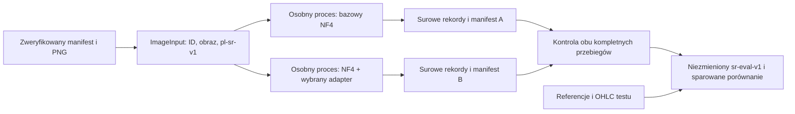

# Etap 4.6A — przygotowanie końcowej ewaluacji

Data: 2026-11-12. **Właściwej inferencji Qwen ani ewaluacji produkcyjnego
zbioru testowego nie wykonano.** Gotowe są implementacja, kontrole offline,
testy i instrukcja dla autora. Nie utworzono `results/vlm46-final-test`.

## Stan przed zmianami i minimalny zakres

Istniały `cli/train_vlm.py`, `cli/evaluate.py`, `adapter_validation.py`,
`io/stability.py` i `workflows/validation.py`. `validate-adapter` obsługiwał
validation i po generowaniu wywoływał ewaluator. `read_split` dopuszczał wyłącznie
train/validation, a stary CLI nie przyjmował test. Te zabezpieczenia są zamierzone.
Samo dopisanie `test` do starego loadera ujawniłoby pole `answer` i mieszało
inferencję z oceną po pierwszym wariancie; nie zastosowano takiej zmiany.

Dodano odrębne moduły i CLI. Wykorzystano istniejące ładowanie NF4,
`prepare_nf4`, ustawienie budżetu, `prepare_input`, `conversation`, dekodowanie,
monitor zasobów i niezmieniony ewaluator. Nie przepisano historycznego pipeline'u.
Początkowy working tree zawierał wcześniejsze, niezacommitowane zmiany 4.3–4.5;
zachowano je. Dowód początkowy: `results/vlm46a-preparation-20261112-a/git-before.txt`.

## Audyt zamrożonego wyboru i danych

Źródło decyzji: `docs/vlm/FINAL_MODEL_SELECTION.json`; nie dokonano nowego wyboru.

| Pole | Zweryfikowana wartość |
|---|---|
| Model | Qwen/Qwen3-VL-2B-Instruct |
| Rewizja | `89644892e4d85e24eaac8bacfd4f463576704203` |
| Eksperyment | `vlm44-extra-epoch` |
| Adapter | `results/vlm44-part2-17554-5354/adapter` |
| SHA-256 wag | `20cbbb8e39ca636108d9533e8e8cc4543371b48eb322fff97999a9b8454ebdf6` |
| SHA-256 manifestu adaptera | `cc11b18830876107d075b560d8abe37b718c46f22725e2d0cbf430b73bae1c83` |
| SHA-256 pliku wyboru | `287e45bd688de30293b129a536086133be380116202ca74a0fe69c6ab9bd921e` |
| Dataset | `data/datasets/ds35-800-20261107-a` |
| SHA-256 manifestu datasetu | `0f9093fbdcbd39243fcf802bfdd723cb913b15838aa4a3cc469787d5e7e462d0` |
| Podział | 698 train / 36 validation / 66 test |
| Historyczne validation | `results/evaluation/vlm44-validation-4184-25636` |

Zweryfikowano oryginalne pliki adaptera, konfigurację efektywną i tożsamość,
hash finalnej walidacji oraz pięć istniejących oficjalnych ocen validation
przez `read_evaluation`. To odtworzenie wcześniej zapisanych ocen, bez inferencji.
Lokalne wagi bazowe, procesor i tokenizer sprawdzono według 11 plików
`base.files` zapisanego identity; brak pobierania lub modyfikacji cache.

Dataset, alternatywny adapter 350, oba checkpointy końcowe, wcześniejsze wyniki,
konfiguracje treningowe, raport 4.5, instrukcja `pl-sr-v1` i cały ewaluator
pozostają chronione inwentarzem przed/po. Wynik kontroli i rzeczywiste liczby
plików: [INTEGRITY_4_6A.json](INTEGRITY_4_6A.json).

## Architektura i równoważność ustawień

Plan `configs/vlm/final-test.json` korzysta z historycznego `stability.json`
przez wspólny `read_configuration`. Wymaga także identyczności z oryginalnym
`results/vlm41-cz2-20261110-1840/base-nf4/config.json`. Zgodność modelu, rewizji,
cache, generowania i budżetów obrazu jest sprawdzana z zamrożonym wyborem 4.5.
Wersje bibliotek i rzeczywista konfiguracja procesora/template są kontrolowane
przy przyszłym ładowaniu modelu względem `training-identity.json` adaptera.

Obie wersje: NF4 z double quantization, compute BF16, wizja BF16;
niekwantyzowane zamrożone części poza wizją zachowują przygotowanie PEFT FP32.
SDPA, wyłącznie cuda:0, bez CPU/disk offload. Budżet 786432, minimum 65536,
oryginalne 1024×768 i 768 tokenów obrazu. `do_sample=false`, `num_beams=1`,
`max_new_tokens=256`, `use_cache=true`. Seed inferencji 20261109 pochodzi
z historycznej konfiguracji bazowej; seed dodatkowego treningu 20261112
nie jest używany jako nowa reguła inferencji. Brak few-shot i zmian temperatury.

Wspólne `prepare_input` zachowuje chat template i tokenizację. Odpowiedź dekoduje
się historycznie przez `batch_decode(skip_special_tokens=True,
clean_up_tokenization_spaces=False)`, a wynikowy tekst przechowuje bez dalszych
zmian. Model nie widzi ID, symbolu, metadanych, etykiet ani OHLC jako promptu.
ID służy tylko organizacji i przypisaniu odpowiedzi.

## Odczyt 66 obrazów bez referencji

Nowy loader odczytuje zweryfikowany manifest. Oczekuje 33 realnych testowych
BTCUSDT i 33 ETHUSDT, unikalnych ID oraz zamrożonego podziału. Sprawdza
PNG/rozmiar i SHA-256. Nie otwiera splitu testowego JSONL, plików metadanych,
etykiet ani CSV w celu parsowania. Integralność tych plików kontroluje wyłącznie
hashowaniem ich nieinterpretowanych bajtów.

Do inferencji powstaje `ImageInput(id, image, instruction)` bez pola `answer`.
Kolejność `(symbol,id)` jest identyczna dla obu modeli. Fingerprint obrazowych
wejść obejmuje manifest, ID, symbol, ścieżkę i hash PNG oraz hash instrukcji:
`086698fa04fff5b8466e1cfc2f8e4986dced0dc18692722d23ad86085988a06d`.
Nie jest to oficjalny fingerprint referencji ewaluatora, który można wyznaczyć
dopiero w późniejszej ocenie. Test z nieparsowalnymi sentinelami zamiast
etykiet/OHLC potwierdził, że loader nie próbuje odczytywać ich znaczenia.

## Autoryzacja i jednorazowość

CLI `python -m market_levels.cli.final_test` ma `dry-run`, `prepare`, `infer`,
`verify-variant`, `verify-pair`, `score-pair`. PowerShell ma te same tryby,
domyślnie `dry-run`. Dataset, wybór i `--split test` są jawne w CLI.
Nie ma przełącznika innego modelu, BF16, promptu ani generowania.

Każde wykonanie tworzące sesję, inferencję lub ocenę wymaga jednocześnie
osobnego planu `purpose=one_final_test_pair_v1`, `execution_approved=true`
i flagi `--approve-final-test` / `-ApproveFinalTest`. Brak zgody kończy się
przed audytem dużych wejść, załadowaniem modelu lub utworzeniem CUDA przez tę ścieżkę.
Zgody full/extra-epoch nie są obsługiwane jako zgody testowe.

Stały nowy katalog `results/vlm46-final-test` rezerwuje jedną parę. `prepare`
nadaje UUID sesji i dwa różne run_id. Plan wiąże kod źródłowy, konfigurację,
dane, wybór, bazę i instrukcję. Inny output/adapter/dataset/fingerprint jest
odrzucany. Istniejącego katalogu nie zastępuje się nową sesją. Ukończony
wariant odrzuca normalne wykonanie i resume; nie ma rankingu powtórzeń.
Blokada OS serializuje procesy i zwalnia się także po ich awaryjnym zakończeniu.
To ochrona przed przypadkowym powtórzeniem, nie ochrona przed świadomą ręczną
edycją kodu, usunięciem rezerwacji lub przeliczeniem hashy przez właściciela plików.

## Zapis odpowiedzi, przerwanie i wznowienie

Punkt zatwierdzenia: atomowo opublikowany `records/NNN-ID.json`, po flush/fsync.
Rekord zawiera pełny surowy tekst, ID, run_id, dane wejścia/tokenizacji,
czas, tokeny wyjściowe i pomiary, hash poprzednika oraz własny hash.
`predictions.jsonl` jest dokładnym, odtwarzanym prefiksem rekordów, po jednym
obiekcie `{id,response}`. Nie ma parsera ani naprawy odpowiedzi w generowaniu.

OOM, wyjątek lub Ctrl+C kończy proces bez retry. Zapisane rekordy pozostają;
nie tworzy się fikcyjnych brakujących odpowiedzi. `--resume` sprawdza oryginalną
sesję/plan/kod, run_id, ciągłość ID i łańcuch hashy. Wznawia od pierwszej
niezatwierdzonej odpowiedzi. Awaria po publikacji rekordu, a przed aktualizacją
prefiksu, nie powoduje ponownego generate() dla tego ID. Zmieniony prefiks jest
odrzucany; brakujący wskutek przerwania jest odbudowywany z rekordów.
Przerwanie podczas końcowej pieczęci także odtwarza manifest z kompletnych
rekordów bez ładowania modelu. `.pending` nie jest zatwierdzoną odpowiedzią.

`run.json` opisuje bazę, rewizję, checkpoint_id, hash adaptera dla finetuned,
dataset, instrukcję, protokół, wspólną strukturę inferencji, sesję i brak
aktualizacji optymalizatora. `events.jsonl` zawiera rzeczywiste środowisko,
ładowanie, ostrzeżenia, błędy i wznowienia. Po 66 odpowiedziach powstaje
`result.json` oraz manifest SHA-256. Oficjalne raporty nie powstają dla prefiksu.
Log konsoli i rzeczywisty kod wyjścia PowerShell zapisuje poza zapieczętowanym
katalogiem. Surowe odpowiedzi i tokeny nie są wypisywane jako miary jakości.

## Model, adapter i zasoby

Baza nie ładuje adaptera. Finetuned ładuje jeden wybrany eksport przez
`PeftModel.from_pretrained(..., is_trainable=False)` bez merge. Przed generowaniem
sprawdza nazwy, dtype, kształty, skończoność i dokładną równość wszystkich 112
tensorów w pamięci względem zweryfikowanego safetensors. Wszystkie parametry
mają `requires_grad=False`, nie mają gradientów, model jest w `eval()`;
generowanie jest objęte `torch.inference_mode()`. Nie powstaje optymalizator.

Przed CUDA: GPU RTX 3060 Ti 8192 MiB i idle VRAM ≤450 MiB, RAM ≥4096 MiB,
commit headroom ≥8192 MiB. Dalej kontrola pojedynczej GPU i natywnego BF16,
wersji środowiska oraz braku offloadu. RAM/commit sprawdza się przed każdą
odpowiedzią. Nie zmniejsza się obrazu ani nie zmienia ustawień po OOM.
Zapas VRAM historycznie był mały; nowej ścieżki Qwen GPU jeszcze nie zmierzono.

## Oddzielenie inferencji od oficjalnej oceny

Finetuned wymaga wcześniej ukończonej bazy. `verify-variant` i `verify-pair`
ujawniają jedynie kompletność/integralność. `score-pair` wymaga osobnej flagi
i obu kompletnych manifestów, zanim wywoła istniejące `evaluate(...,split='test')`,
`read_evaluation`, `compare` i `read_comparison`. Nie zmienia `sr-eval-v1`.
Powtórzenie przerwanej oceny sprawdza już istniejące raporty i ich surowe wejścia,
nie generuje ponownie odpowiedzi i nie nadpisuje poprawnych raportów.

Wspólny `inference` zawiera również rewizję bazową, dzięki czemu historyczny
compare wymusza jej zgodność bez zmiany ewaluatora. Wymagany jest ten sam
oficjalny binding/fingerprint i 66 ID, instrukcja, protokół oraz różne run_id.
Główne 0,5 ATR i pomocnicze 0,25/1,0 ATR pozostają niezmienne. Wszystkie
istniejące przekroje, błędy formatu i MAE/ATR dopasowanych par pozostają dostępne.
Nie założono z góry błędu formatu bazy na teście i nie dodano automatycznej
diagnostyki zdejmowania Markdown. Ewentualna późniejsza analiza pomocnicza musi
zachować już istniejącą regułę, odrębny opis i nie wpływać na wybór modelu.

## Testy i faktyczne wykonania przygotowawcze

| Kontrola | Wynik |
|---|---|
| Końcowy pełny unittest, istniejące `.venv` | 407/407 OK; 146,369 s w runnerze |
| Nowe testy w tym zestawie | 29 jednostkowych + 1 integracyjny |
| Końcowy lekki PyTorch/PEFT CPU w środowisku VLM | 2/2 OK, bez inicjalizacji CUDA |
| Oficjalne evaluate/test, compare, verify | OK na nowym sztucznym fixture dwóch ID z rokiem 2000 |
| Historyczne oficjalne validation | 5 raportów odtworzonych offline |
| CLI dry-run / brak zgody | kody 0 / 1; brak produkcyjnej sesji |
| Natywny PowerShell dry-run / brak zgody / inny dataset | kody 0 / 1 / 1 |

Testy obejmują autoryzację, rewizję/model, generowanie/budżet, inną ścieżkę
wyboru i adaptera, SHA-256 oraz fingerprint, inne splity, ponowny output,
ID nieznane/powtórzone/brakujące, surowy tekst bez naprawy, manifesty,
równoważność metadanych, brak adaptera w bazie, dokładne tensory, eval/no-grad,
guard przed CUDA, OOM/przerwanie, STOP, resume, awarię pomiędzy rekordem
i prefiksem oraz podczas pieczęci, brak ponownej generacji i brak wczesnej oceny.
Testy architektury i dotychczasowe blokady także przeszły.

Nie ukryto nieudanych prób przygotowawczych. Pierwszy pełny zestaw (404 testy
przed dopisaniem trzech kontroli) miał jeden błąd sprzątania nowego fixture:
WinError 32. Nowy test korzysta teraz z istniejącego `_cleanup` z ponowieniami.
Początkowe podprocesy miały także ostrzeżenia kodowania; końcowy runner ustawia
PYTHONUTF8=1 i PYTHONIOENCODING=utf-8 także dla podprocesów.

Pierwszy test lekkiego PEFT, mimo CPU i CUDA_VISIBLE_DEVICES, wykrył
`torch.cuda.is_initialized()==True` wskutek automatycznej detekcji urządzenia.
Nie ładował Qwen ani obrazów produkcyjnych. W końcowej kontroli przed importem
PEFT blokuje się `cuda.is_available` i `_lazy_init`; oba testy przeszły,
z potwierdzeniem braku kontekstu CUDA. Nie jest zatem prawdą, że w całym
przygotowaniu nigdy nie zainicjalizowano CUDA; nie wykonano natomiast inferencji
na produkcyjnym teście ani generowania przez Qwen. Dowód i korekta są zachowane.

Logi: `results/vlm46a-preparation-20261112-a/tests-{initial,final}.log`,
`tests-*-exit.json`, `cpu-initial-failure.json`, `cpu46-final.log`,
`cpu46-final-exit.json`, `cli-checks.json`, `powershell-checks.json`
i `historical-validation-checks.json`. Testy CPU i mocki nie potwierdzają
stabilności pełnego Qwen ani deterministyczności CUDA po wznowieniu.

## Zmienione i nowe pliki

- Nowe: `src/market_levels/inference/final_config.py`,
  `io/{final_inputs,final_state,final_model}.py`,
  `workflows/{final_test,final_scoring}.py`, `src/market_levels/cli/final_test.py`.
- Nowe: `configs/vlm/final-test.json`, `scripts/run_vlm_final_test.ps1`,
  `scripts/package_vlm46_results.py`, skrypt audytu/pakowania przygotowania.
- Nowe testy: `tests/unit/modeling/test_final_test.py`,
  `tests/integration/evaluation/test_final_test_fixture.py`,
  `tests/checks/check_vlm46_backend.py`.
- Dokumenty: niniejszy raport, [PowerShell](INSTRUKCJA_POWERSHELL_4_6.md),
  [szablon 4.6B](SZABLON_RAPORTU_4_6B.md), aktualizacje `.ai`, README i architektury.

Żaden wcześniejszy moduł produkcyjny, konfiguracja treningowa, ewaluator,
raport 4.5 lub wybrany checkpoint nie został zmieniony w 4.6A.
Nie wykonywano commit/push/reset/clean/stash. Wcześniejsze zmiany autora
pozostały. Pełny inwentarz przed pracą pozostaje lokalnie; mała paczka ma podsumowanie.

## Ograniczenia i przekazanie

Kod jest sprawdzony offline i na lekkim CPU; właściwe ładowanie Qwen/NF4
oraz 66 generacji pozostają do wykonania przez autora po audycie. Hashy
nie należy traktować jako podpisów autentyczności. Rezerwacja jednej sesji
wymaga zachowania jej katalogu i kodu. Twarda awaria przed atomowym
zatwierdzeniem odpowiedzi może wymagać jej ponownej generacji; zatwierdzone
odpowiedzi pozostają niezmienione. Próbek VRAM nie należy nazywać ciągłym
pomiarem fizycznej pamięci, a rezerwacji alokatora pod WDDM sumować z VRAM.

Test obejmuje małą, czasowo przesuniętą próbę i referencje algorytmiczne,
nie obiektywną prawdę rynkową. Jego wyniki nie mogą zmienić wyboru 4.5.
Szablon 4.6B nie zawiera wyników testowych ani oczekiwanych F1.

Handoff przygotowania: `handoff/vlm46a-test-preparation-20261112-a.zip`,
obok `.manifest.json` i `.zip.sha256`. Zawiera nowy kod, testy, plan,
dokumentację i małe dowody; nie zawiera wag, adapterów, checkpointów,
state.pt, produkcyjnych obrazów/etykiet/CSV, datasetu, cache i środowisk.
ZIP jest dodatkiem do bieżącego repozytorium, nie samodzielnym środowiskiem.
Skrypt przyszłego pakowania wyników przygotowano, ale nie wykonano go na
rzeczywistych wynikach, ponieważ jeszcze nie istnieją.

**Przygotowanie 4.6A zakończone. Dalsza inferencja i ocena wymagają ręcznego
wykonania przez autora po niezależnej kontroli.**
